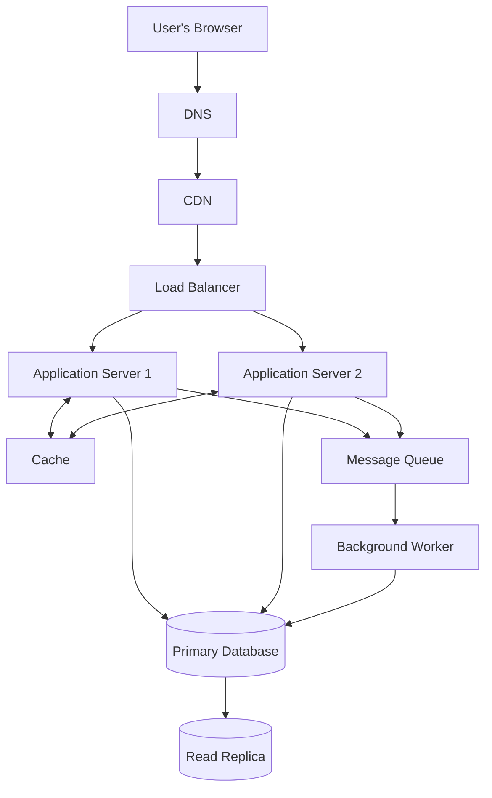

# QuickNotes System Architecture

## 1. Overview

QuickNotes is a web application that allows users to create, view, update, delete, and organize notes. Its architecture must support reliable access, secure data storage, and growth as the number of users increases.

The proposed architecture uses a CDN, load balancer, multiple application servers, a cache, a primary database, a read replica, and a message queue with background workers.

## 2. Functional Requirements

1. Users can register and authenticate securely.
2. Authenticated users can create, view, update, and delete their own notes.
3. Users can organize notes using tags.
4. Users can search and retrieve notes.
5. The system validates requests and returns meaningful error messages.
6. The system prevents users from accessing other users' private notes.

## 3. Nonfunctional Requirements

1. **Availability:** Users should be able to access their notes reliably.
2. **Performance:** Common note-reading requests should return quickly.
3. **Scalability:** The system should support growth in users and requests.
4. **Security:** Authentication, authorization, and encryption must protect user data.
5. **Durability:** Saved notes should not be lost during normal server failures.
6. **Maintainability:** Components should be independently testable and deployable where practical.

## 4. Architecture Diagram

The diagram shows the main request path and supporting infrastructure. In production, the cache, database, queue, and servers should be configured with suitable replication or failover mechanisms.

## 5. Component Responsibilities

| Component | Problem it solves |
|---|---|
| Client / Browser | Provides the interface for users to manage notes. |
| DNS | Resolves the application domain name to the appropriate network endpoint. |
| CDN | Serves static assets such as CSS, JavaScript, and images from locations closer to users. |
| Load Balancer | Distributes incoming requests across application servers and avoids depending on a single application instance. |
| Application Servers | Run business logic, validate requests, authenticate users, and communicate with storage services. |
| Cache | Stores frequently accessed data temporarily to reduce database load and improve response time. |
| Primary Database | Stores authoritative, durable records for users, notes, and tags. |
| Read Replica | Handles eligible read queries and can reduce read pressure on the primary database. |
| Message Queue | Buffers asynchronous tasks so temporary traffic spikes do not overwhelm background processing. |
| Background Worker | Processes queued tasks such as notifications and other work that does not need to block the user's request. |

## 6. Load Estimates for One Million Users

These are planning assumptions rather than measured production traffic.

Assume:

- 1,000,000 registered users.
- 10% of registered users are active on an average day: 100,000 daily active users.
- Each active user performs 20 reads and 2 writes per day.
- Traffic is averaged across 24 hours.
- Each stored note, including its average database overhead, uses approximately 2 KB.
- Each active user creates 2 notes per day.
- Note storage estimates exclude backups, indexes beyond the assumed overhead, replicas, logs, and other application data.

### Estimated average request rates

Daily reads:

100,000 users × 20 reads = 2,000,000 reads/day.

Average reads per second:

2,000,000 ÷ 86,400 ≈ 23 reads/second.

Daily writes:

100,000 users × 2 writes = 200,000 writes/day.

Average writes per second:

200,000 ÷ 86,400 ≈ 2.3 writes/second.

| Metric | Estimated average |
|---|---:|
| Registered users | 1,000,000 |
| Daily active users | 100,000 |
| Reads per day | 2,000,000 |
| Writes per day | 200,000 |
| Reads per second | About 23 |
| Writes per second | About 2.3 |

Real traffic is uneven. If peak traffic is ten times the average, the system should be designed to handle approximately 230 reads/second and 23 writes/second under these assumptions. Capacity testing is needed to validate this estimate.

### Estimated annual note storage

Assume each daily active user creates two notes per day:

100,000 users × 2 notes = 200,000 new notes/day.

Annual note count:

200,000 × 365 = 73,000,000 notes/year.

At approximately 2 KB per note:

73,000,000 × 2 KB = 146,000,000 KB, or approximately 146 GB per year using decimal units.

This estimate covers newly created notes only. Actual storage will vary with note length, edits, deletions, metadata, indexes, and database overhead.

## 7. GET `/api/notes` Request Flow

1. The user opens QuickNotes and requests their notes.
2. DNS resolves the application's domain.
3. The CDN serves any cached static assets; personalized API responses should not be publicly cached.
4. The load balancer forwards the API request to a healthy application server.
5. The application server validates the access token and determines the authenticated user.
6. The server checks the cache for an appropriate entry keyed by user and query parameters.
7. If valid cached data exists, the server returns it. Otherwise, it queries the primary database or an appropriately up-to-date read replica.
8. The server returns the notes as JSON.
9. If the response was obtained from the database, the application may update the cache using a suitable expiration and invalidation strategy.

Authorization must be enforced even when a cache entry is used. Cache keys and permissions must prevent one user from receiving another user's notes.

## 8. POST `/api/notes` Request Flow

1. The user submits a new note from the browser.
2. The request travels through DNS, the CDN, and the load balancer to a healthy application server.
3. The application server validates the access token and checks the title and body.
4. The server inserts the note into the primary database, associating it with the authenticated user.
5. The database commits the transaction and returns the saved note.
6. The application invalidates or updates affected cached note lists.
7. The server responds with `201 Created` and the created note as JSON.
8. If additional asynchronous work is required, such as sending a notification, the application can enqueue a task for a background worker.

The API should not report a note as successfully saved until the database transaction has committed. Queueing an optional background task should not replace saving the note itself.

## 9. Architecture Trade-offs

### A. Cache versus database consistency

**Benefit:** Caching can reduce database load and make frequent reads faster.

**Trade-off:** Cached data may become stale after a note is updated or deleted.

**Mitigation:** Invalidate or update relevant cache entries after successful writes, use expiration times, and avoid publicly caching private note responses.

### B. Read replica versus immediate consistency

**Benefit:** A read replica can handle additional read traffic and reduce pressure on the primary database.

**Trade-off:** Replication lag may cause a user to temporarily see old data after a write.

**Mitigation:** Send read-after-write requests to the primary database when necessary, and monitor replication lag.

### C. Multiple application servers versus operational complexity

**Benefit:** Multiple instances improve capacity and allow requests to continue when one instance fails.

**Trade-off:** Deployments, monitoring, and shared session management become more complex.

**Mitigation:** Keep application instances stateless where possible, externalize shared session or cache data, and use health checks with automated replacement.

### D. Synchronous versus asynchronous processing

**Benefit:** A message queue lets nonessential tasks run in the background and absorb temporary bursts of work.

**Trade-off:** Background work may be delayed, duplicated, or fail.

**Mitigation:** Make jobs retryable and idempotent, monitor queue depth, and use a dead-letter queue for tasks that repeatedly fail.

## 10. Avoiding Single Points of Failure

- **Application servers:** Run multiple instances behind a load balancer and replace unhealthy instances automatically.
- **Load balancer and DNS:** Use a managed or redundant load-balancing setup and reliable DNS hosting.
- **Cache:** Use a managed cache with suitable replication or failover; the application should degrade gracefully if the cache is unavailable.
- **Database:** Configure backups, point-in-time recovery, and a tested primary failover procedure. Use replication where appropriate.
- **Message queue:** Use a durable, replicated queue and monitor processing delays.
- **Background workers:** Run multiple worker instances and support retries and idempotent processing.

Redundancy alone does not guarantee reliability. Failover procedures, backups, monitoring, and recovery tests are necessary to confirm that the system can recover from failures.

## 11. Conclusion

This architecture provides a path for QuickNotes to grow while keeping note data durable and private. Multiple application servers, caching, database replication, and asynchronous workers address different scaling and reliability challenges. These components should be introduced and sized according to measured traffic, performance requirements, and operational capacity rather than deployed unnecessarily at the earliest stage.
